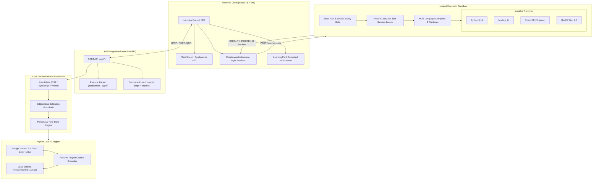
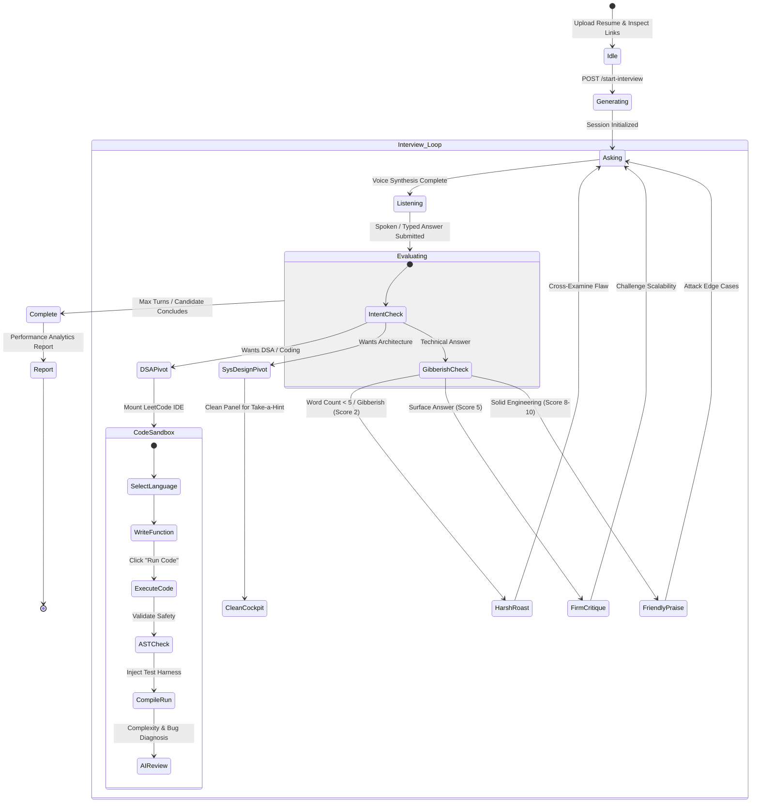
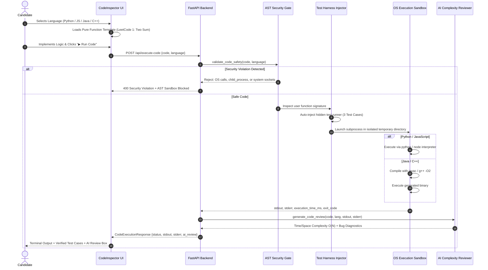

# 🚀 ResumeGrind — AI Voice Mock Interviewer & LeetCode Sandbox

> **An intelligent, resume-grounded technical interview platform powered by Google Gemini & Fine-Tuned LLaMA-3.**  
> ResumeGrind deep-crawls your resume, GitHub repositories, and live projects, conducting an **interactive multi-turn voice interview** with real-time tone adaptation, an interactive **LeetCode-style multi-language sandbox** (Python, JavaScript, Java, C++), and **project-grounded answer hints** tied directly to your actual engineering experience.

---

## 📌 Table of Contents
1. [The Problem: Why Traditional Interview Prep Fails](#-the-problem-why-traditional-interview-prep-fails)
2. [The Solution: How ResumeGrind Solves It](#-the-solution-how-resumegrind-solves-it)
3. [System Architecture & Deep Dive](#-system-architecture--deep-dive)
   - [High-Level Component Architecture](#1-high-level-component-architecture)
   - [Multi-Turn Interview State Machine](#2-multi-turn-interview-state-machine)
   - [Multi-Language Sandboxed Compiler Pipeline](#3-multi-language-sandboxed-compiler-pipeline)
   - [Resume-Grounded "Take a Hint" Architecture](#4-resume-grounded-take-a-hint-architecture)
4. [Complete Tech Stack](#-complete-tech-stack)
5. [Interactive Cockpit & Multi-Language Code Sandbox](#-interactive-cockpit--multi-language-code-sandbox)
6. [Getting Started & Local Setup](#-getting-started--local-setup)
7. [Configuration & Environment Variables](#-configuration--environment-variables)
8. [API Endpoints Reference](#-api-endpoints-reference)
9. [Fine-Tuning & Local Ollama Setup](#-fine-tuning--local-ollama-setup)
10. [Project Directory Layout](#-project-directory-layout)
11. [Pro Tips for Success](#-pro-tips-for-success)
12. [License](#-license)

---

## 🛑 The Problem: Why Traditional Interview Prep Fails

Practicing for high-bar technical interviews at top technology firms is traditionally broken due to several critical flaws in existing tools:

### 1. Disconnection from Candidate's Real Experience
Generic mock interview platforms ask standardized, canned questions (*"What is Polymorphism?", "Explain REST APIs"*). They know nothing about your actual production architecture, pull requests, trade-offs, or database schemas. As a result, candidates are never tested on whether they can defend the claims, design choices, and systems listed on their resumes.

### 2. The "Blind Praise" & Sycophancy Trap
Standard LLMs suffer from sycophancy: when a candidate submits a low-effort 3-word response or complete gibberish (e.g., *"Very rhythmi Gandhi"*), standard bots still respond with *"Spot on! Fantastic, clear, and well-structured answer!"*. This gives candidates a dangerous, false sense of security and completely fails to prepare them for demanding technical interviewers who relentlessly probe shallow answers.

### 3. Disconnected Coding Assessments
Traditional platforms force candidates into either pure verbal interviews or external, disconnected LeetCode browser tabs. There is no unified cockpit where the interviewer verbally transitions from your project architecture directly into a synchronized LeetCode coding problem, automatically evaluating your implementation across multiple languages.

### 4. Excessive Boilerplate in Coding Sandboxes
Many browser IDEs force candidates to write full input parsing (`sys.stdin`, `Scanner`, `cin`) and console formatting boilerplate instead of focusing solely on algorithmic function logic like real LeetCode and senior technical screens.

### 5. High Latency of Local Models
Running local 8B+ parameter models often incurs a 20–30 second latency per turn on consumer hardware. During a real-time voice interview, that delay breaks conversational immersion unless paired with a high-speed cloud engine (~1.8s) and intent-gated caching.

---

## 💡 The Solution: How ResumeGrind Solves It

ResumeGrind transforms interview preparation into an immersive, realistic pair-programming and cross-examination experience:

```
  ┌──────────────────────────────────────────────────────────────────────────┐
  │                           RESUMEGRIND PLATFORM                           │
  ├────────────────────────────────────┬─────────────────────────────────────┤
  │   1. Deep Resume & Repo Ingestion  │   2. Dynamic Multi-Turn Cockpit     │
  │   - PDF AST Text & Skill Parser    │   - Web Speech Synthesis & STT      │
  │   - Concurrent GitHub REST Crawler │   - Intent-Gated Mode Switching     │
  ├────────────────────────────────────┼─────────────────────────────────────┤
  │   3. Grounded Take-a-Hint System   │   4. Multi-Language Code Sandbox    │
  │   - Direct linkage to your projects│   - Python, JS, Java, C++ compilers │
  │   - Architecture trade-off hints   │   - Hidden LeetCode Test Harness    │
  ├────────────────────────────────────┴─────────────────────────────────────┤
  │                     5. Hybrid Dual LLM Engine                             │
  │      - Fine-Tuned Local LLaMA 3.2 (Custom Modelfile & LoRA)              │
  │      - Ultra-Fast Cloud Fallback (Gemini 3.5 Flash Lite ~1.8s)            │
  └──────────────────────────────────────────────────────────────────────────┘
```

1. **Deep Project Grounding & Verification:** Parses PDF resumes, extracts embedded URLs via `pdfplumber`, and crawls your public GitHub repos. Questions directly target your actual production stack (e.g., FastAPI, Kafka, Redis, PostgreSQL).
2. **Strict Guardrails & Adaptive Tone:** Built-in heuristic and semantic filters detect deflection, trivia, and gibberish. Trivial 3-word answers are immediately scored **2/10** with a harsh reality check. Solid answers receive enthusiastic validation and edge-case cross-examination.
3. **Synchronized Live Coding Pivot:** Saying *"move on to the dsa"* instantly synchronizes both the conversational chat and the right panel sandbox, presenting a LeetCode problem with constraints and clean function signatures.
4. **Pure Function Sandbox with Automated Test Runner:** Candidates write pure logic in **Python**, **JavaScript**, **Java**, or **C++**. The runner attaches hidden unit tests, compiles the program, and returns test outcomes with an **AI Code Review** containing time and space complexity analysis.
5. **Resume-Grounded "Take a Hint":** Clicking **Take a Hint** does not show generic textbook definitions. It generates guidance showing exactly **how to answer that question using the specific technologies and architecture from your resume**.
6. **Dual-Engine LLM Architecture:** Combines a local fine-tuned model (`ResumeGrind-Llama3`) with Google Gemini (`gemini-3.5-flash-lite`), maintaining sub-2-second response latency.

---

## 🏛️ System Architecture & Deep Dive

### 1. High-Level Component Architecture



---

### 2. Multi-Turn Interview State Machine



---

### 3. Multi-Language Sandboxed Compiler Pipeline



---

### 4. Resume-Grounded "Take a Hint" Architecture

```mermaid
graph LR
    subgraph Trigger
        BTN["User clicks 'Take a Hint'"]
    end

    subgraph Backend_Retrieval["Context Grounding Engine"]
        Q["Active Question Text"]
        RES["Parsed Candidate Resume"]
        PROJ["Extracted Projects & Stack (FastAPI, Redis, Kafka, PostgreSQL)"]
    end

    subgraph Generation["Gemini Prompt Grounder"]
        PRMPT["Instruction: Ground answer strictly in candidate's resume projects"]
        GEN["gemini-3.5-flash-lite"]
    end

    subgraph Presentation["LearningCard Output"]
        TH["1. Core Theory & Mechanics"]
        ARCH["2. Architecture ASCII Diagram"]
        TBL["3. Trade-offs Table"]
        HINT["4. 💡 How to Answer Using Your Resume Project"]
    end

    BTN --> Q
    Q --> Backend_Retrieval
    RES --> PROJ
    PROJ --> PRMPT
    Q --> PRMPT
    PRMPT --> GEN
    GEN --> Presentation
```



---

## 🛠️ Complete Tech Stack

### 🎨 Frontend Architecture
- **Framework:** [React 18](https://react.dev/) with [Vite](https://vitejs.dev/) (fast HMR)
- **Styling:** [Tailwind CSS 3](https://tailwindcss.com/) with custom dark neon gradients & animations
- **Icons & UI:** [Lucide React](https://lucide.dev/)
- **Animations:** [Framer Motion](https://www.framer.com/motion/) for collapsible panels and drawers
- **Speech & Audio Studio:** Browser-native **Web Speech API** (`SpeechSynthesis` & `webkitSpeechRecognition`) with waveform visualization, audio level monitoring, and auto-listening state transitions
- **HTTP Client:** [Axios](https://axios-http.com/) with request/response interceptors

### ⚙️ Backend & Systems Architecture
- **Web Framework:** [FastAPI](https://fastapi.tiangolo.com/) (Python 3.11 / 3.14)
- **ASGI Server:** [Uvicorn](https://www.uvicorn.org/) with multi-worker support
- **Data Validation & Schemas:** [Pydantic v2](https://docs.pydantic.dev/) with strict type validation
- **Resume Parsing & Ingestion:**
  - `pypdf` & `pdfplumber` for structured text and hyperlink extraction
  - `httpx` & `asyncio.gather` for concurrent crawling of GitHub repositories and portfolio URLs
- **Sandbox Code Execution Engine:**
  - Isolated subprocess execution via `asyncio.create_subprocess_exec`
  - Ephemeral file management with zero disk leakage (`tempfile` + clean teardown)
  - Static AST security gate blocking system calls (`os`, `sys`, `subprocess`, `child_process`, `ProcessBuilder`)

### 🤖 AI, LLM & Machine Learning
- **Cloud LLM:** Google Gemini (`gemini-3.5-flash-lite` via `google-genai` SDK)
- **Local LLM Engine:** [Ollama](https://ollama.ai/) running `ResumeGrind-Llama3` (Fine-tuned Llama-3.2-3B Instruct with custom GGUF and Modelfile)
- **Fine-Tuning Pipeline:** Synthetic dataset generator (`backend/scripts/generate_synthetic_dataset.py`) + Google Colab training notebook (`ResumeGrind_Training.ipynb`)

### 💻 Compilers & Runtimes Supported in Live Sandbox
- **Python:** Python 3.14 / 3.11 Virtualenv
- **JavaScript:** Node.js v24 LTS
- **Java:** OpenJDK 21 LTS (`javac` + `java`)
- **C++:** MinGW GCC 6.3 / G++ (`g++ -O2`)

---

## 💻 Interactive Cockpit & Multi-Language Code Sandbox

The Code Sandbox is embedded directly in the interview cockpit:

### Supported Languages & Compilers
| Language | Compiler / Runtime | Test Harness Injection | Complexity Analysis |
| :--- | :--- | :--- | :--- |
| **Python 3** | Python Virtualenv | Class `Solution` auto-runner | ✅ $O(N)$ Time / $O(N)$ Space |
| **JavaScript** | Node.js v24 | Function `twoSum` auto-runner | ✅ Map lookup efficiency |
| **Java 21** | OpenJDK 21 (`javac`) | `SolutionRunner` class wrap | ✅ Arrays & HashMap analysis |
| **C++** | MinGW G++ (`-O2`) | `main()` verification harness | ✅ `unordered_map` vector review |

### Pure LeetCode Function Signature
Candidates only write the function logic without I/O boilerplate:

```python
# LeetCode 1: Two Sum
# Constraints: 2 <= nums.length <= 10^4, -10^9 <= nums[i] <= 10^9, -10^9 <= target <= 10^9

class Solution:
    def twoSum(self, nums: list[int], target: int) -> list[int]:
        seen = {}
        for i, num in enumerate(nums):
            diff = target - num
            if diff in seen:
                return [seen[diff], i]
            seen[num] = i
        return []
```

When **▶ Run Code** is clicked, the sandbox:
1. Validates AST safety against OS manipulation.
2. Injects hidden test cases:
   - `nums = [2, 7, 11, 15], target = 9` $\rightarrow$ `[0, 1]`
   - `nums = [3, 2, 4], target = 6` $\rightarrow$ `[1, 2]`
   - `nums = [3, 3], target = 6` $\rightarrow$ `[0, 1]`
3. Executes the program and returns test outcomes with an **AI Code Review**:
   > `✅ LeetCode Accepted! Passed all test cases in 43ms (Python). Optimal Time Complexity: O(N) linear time using Hash Map lookup. Space Complexity: O(N) auxiliary space. Excellent work!`

---

## 🚀 Getting Started & Local Setup

### Prerequisites
- **Git** (`git --version`)
- **Python 3.11+** (`python --version`)
- **Node.js 18+** (`node --version`)
- **C++ Compiler** (MinGW G++ or GCC) — *For C++ sandbox execution*
- **Java JDK 21+** (`java --version`) — *For Java sandbox execution*
- **Google Gemini API Key** ([Get your free key here](https://aistudio.google.com/))

### 1. Clone the Repository
```bash
git clone https://github.com/RahulUpadhyaay/ResumeGrind.git
cd ResumeGrind
```

### 2. Backend Setup
```bash
cd backend

# Create and activate virtual environment
python -m venv venv
venv\Scripts\activate        # Windows
# source venv/bin/activate   # macOS / Linux

# Install dependencies
pip install -r requirements.txt

# Create .env file and insert your API key
echo GEMINI_API_KEY=your_gemini_api_key_here > .env

# Start FastAPI server
python -m uvicorn app.main:app --host 127.0.0.1 --port 8000 --reload
```
The backend API is now running at `http://127.0.0.1:8000`. Interactive docs are available at `http://127.0.0.1:8000/docs`.

### 3. Frontend Setup
```bash
# In a new terminal window:
cd frontend

# Install dependencies
npm install

# Start Vite dev server
npm run dev
```
The frontend is now accessible at `http://localhost:5173`.

---

## ⚙️ Configuration & Environment Variables

Create a `.env` file in the `backend/` directory:

```env
# Google Gemini API Key (Required for cloud evaluation)
GEMINI_API_KEY=AIzaSy...

# Optional: Default Primary Gemini Model (Defaults to gemini-3.5-flash-lite)
GEMINI_MODEL=gemini-3.5-flash-lite

# Optional: Local Ollama URL (Defaults to http://127.0.0.1:11434)
OLLAMA_BASE_URL=http://127.0.0.1:11434
```

---

## 📡 API Endpoints Reference

| Method | Endpoint | Description |
| :--- | :--- | :--- |
| `POST` | `/api/upload-resume` | Upload PDF resume, extract text, skills, and embedded links |
| `POST` | `/api/inspect-links` | Concurrently crawl GitHub repositories and portfolio URLs |
| `POST` | `/api/start-interview` | Initialize interview session and generate opening question |
| `POST` | `/api/submit-answer` | Submit spoken/written answer, evaluate score, and receive follow-up |
| `POST` | `/api/execute-code` | Sandboxed multi-language code runner with test harness & AI review |
| `POST` | `/api/teach-concept` | Generate "Take a Hint" card grounded in candidate's resume projects |
| `GET` | `/api/session-report/{id}` | Retrieve comprehensive interview feedback report |
| `GET` | `/api/health` | Health check endpoint |

---

## 🦙 Fine-Tuning & Local Ollama Setup

ResumeGrind includes a full pipeline to fine-tune LLaMA-3.2 on synthetic technical interview datasets:

1. **Generate Dataset:**
   ```bash
   python backend/scripts/generate_synthetic_dataset.py
   ```
   Generates `synthetic_interview_dataset.json` with multi-turn system design and algorithmic challenges.

2. **Train Model (LoRA with Unsloth in Colab):**
   Open [`ResumeGrind_Training.ipynb`](./ResumeGrind_Training.ipynb) in Google Colab and run with GPU acceleration.

3. **Deploy Model to Ollama:**
   ```bash
   ollama create ResumeGrind-Llama3 -f Modelfile
   ollama run ResumeGrind-Llama3
   ```

---

## 📂 Project Directory Layout

```
ResumeGrind/
├── backend/
│   ├── app/
│   │   ├── api/
│   │   │   └── routes.py              # FastAPI endpoints
│   │   ├── schemas/
│   │   │   └── models.py              # Pydantic data schemas
│   │   ├── services/
│   │   │   ├── code_executor.py       # Multi-language sandboxed runner
│   │   │   ├── link_inspector.py      # Concurrent GitHub & web scraper
│   │   │   ├── resume_parser.py       # PDF extraction engine
│   │   │   └── providers/
│   │   │       ├── gemini_provider.py # Gemini 3.5 Flash Lite engine
│   │   │       └── ollama_provider.py # Local Ollama LLM provider
│   │   └── main.py                    # Application entry point
│   ├── scripts/
│   │   └── generate_synthetic_dataset.py
│   └── requirements.txt
├── frontend/
│   ├── src/
│   │   ├── api/
│   │   │   └── client.js              # Axios API client
│   │   ├── components/
│   │   │   ├── CodeInspector.jsx      # Multi-language LeetCode IDE
│   │   │   ├── InterviewCockpit.jsx   # Live voice interview studio
│   │   │   ├── LearningCard.jsx       # Take a Hint masterclass
│   │   │   ├── ResumeUpload.jsx       # Resume drag-and-drop
│   │   │   └── VoiceVisualizer.jsx    # Real-time audio waveform
│   │   ├── hooks/
│   │   │   ├── useInterview.js        # Multi-turn state management
│   │   │   └── useSpeech.js           # Web Speech API hooks
│   │   └── App.jsx
│   ├── package.json
│   └── tailwind.config.js
├── Modelfile                          # Custom Ollama model configuration
├── README.md                          # Full system documentation
└── .gitignore                         # Repository clean filters
```

---

## 💡 Pro Tips for Success

To get the most out of your interview preparation with **ResumeGrind**, keep these expert tips in mind:

### 1. 🎙️ Interview Cockpit & Conversation Strategy
- **Use Cockpit Directives:** You can steer the interview anytime! Type or say `COMMAND: DSA` or click the **`[💻 Switch to DSA]`** pill to jump straight to LeetCode mode. Use `COMMAND: System Design` to test distributed systems, or `COMMAND: Next Question` to gracefully advance topics.
- **Defend Real Architecture Decisions:** The interviewer inspects your actual GitHub code and resume. Be prepared to explain *why* you chose specific databases, how you handled race conditions, and how your system behaves under 10,000 concurrent writes/sec.
- **Avoid Sycophancy Traps:** Do not give superficial 2-word answers (e.g., *"Very rhythmi Gandhi"*). ResumeGrind's anti-gibberish guardrails strictly penalize low-effort responses (Score: 2/10) with an aggressive Bar-Raiser reprimand.
- **Leverage "Take a Hint":** If you get stuck on a difficult system design question, click **"Take a Hint"** on the right panel. It will generate a tailored hint grounded in the actual projects listed on your resume.

### 2. 💻 Code Sandbox & Algorithm Assessment
- **Write Pure Function Logic:** No input/output parsing boilerplate (`Scanner`, `cin`, `sys.stdin`) is needed. Simply implement the function stub (e.g., `def twoSum(self, nums, target)`), exactly like real LeetCode and FAANG technical screens.
- **Strive for Optimal Time Complexity:** Brute-force $O(N^2)$ solutions will pass basic unit tests but get penalized with lower scores ($6/10$). Implement optimal single-pass $O(N)$ solutions using Hash Maps or Two Pointers to earn top ratings ($9-10/10$).
- **Test Before Submitting:** Always click **"▶ Run Code"** first to execute against the sandbox unit test suite. Once all test cases pass, click **"Submit"** to send your solution directly to the AI interviewer for verbal code review and space/time complexity cross-examination.

### 3. 🗣️ Speech Delivery & Acoustic Coaching
- **Pacing Target (120–150 WPM):** Maintain an optimal conversational speaking speed. The built-in speech analyzer flags speech under 110 WPM as *Hesitant* and over 165 WPM as *Fast*.
- **Reduce Filler Words:** Consciously minimize words like *"um"*, *"like"*, *"basically"*, and *"actually"*. Your post-interview diagnostic report highlights exact filler frequencies and counts.
- **Apply the Google XYZ Framework:** Structure all project experience using Google's standard impact formula:  
  $$\text{Accomplished [X] as measured by [Y] by doing [Z]}$$  
  *(e.g., "Architected a distributed async task queue with Redis and Kafka [Z], cutting p99 latency from 450ms to 48ms [Y] under 15k RPM [X].")*

### 4. ⚡ Performance & Workflow
- **Use Gemini 3.5 Flash-Lite for Live Interviews:** For ultra-fast ~1.8s conversational turns and smooth voice audio, choose Gemini in the setup screen.
- **Use Local Ollama for Offline Practice:** When practicing offline or preserving local privacy, launch `run_ollama.bat` to run the fine-tuned LLaMA-3 model completely on your local machine.
- **One-Click Startup:** Simply double-click `start_project.bat` in the root folder to automatically boot both the FastAPI backend and React frontend together!

---

## 📄 License
This project is open-source and available under the [MIT License](LICENSE).
