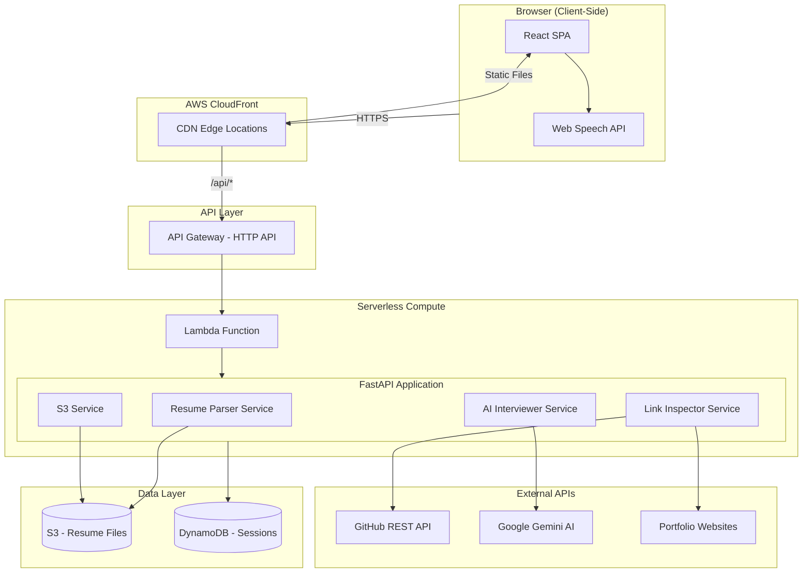
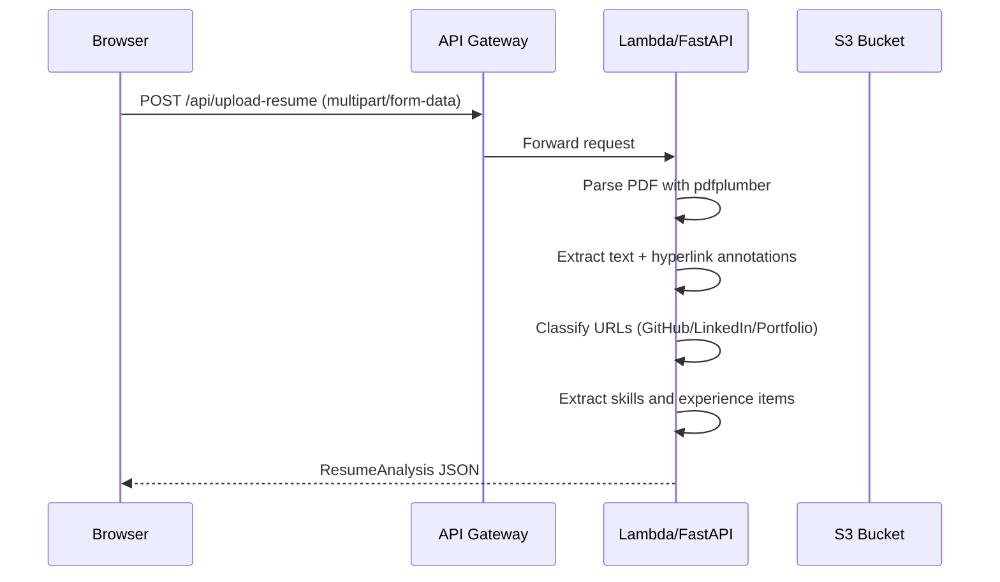
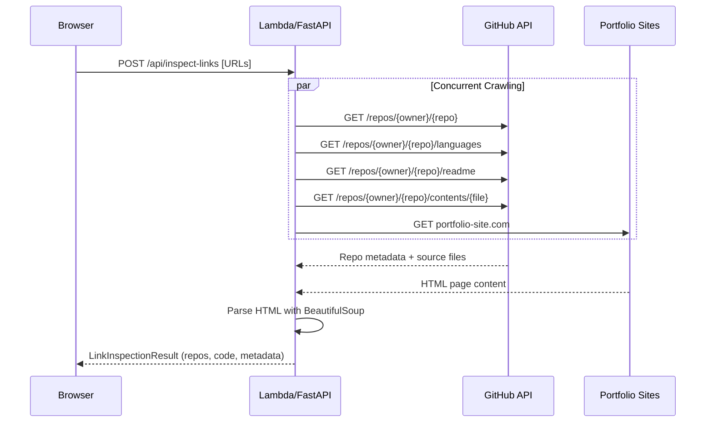
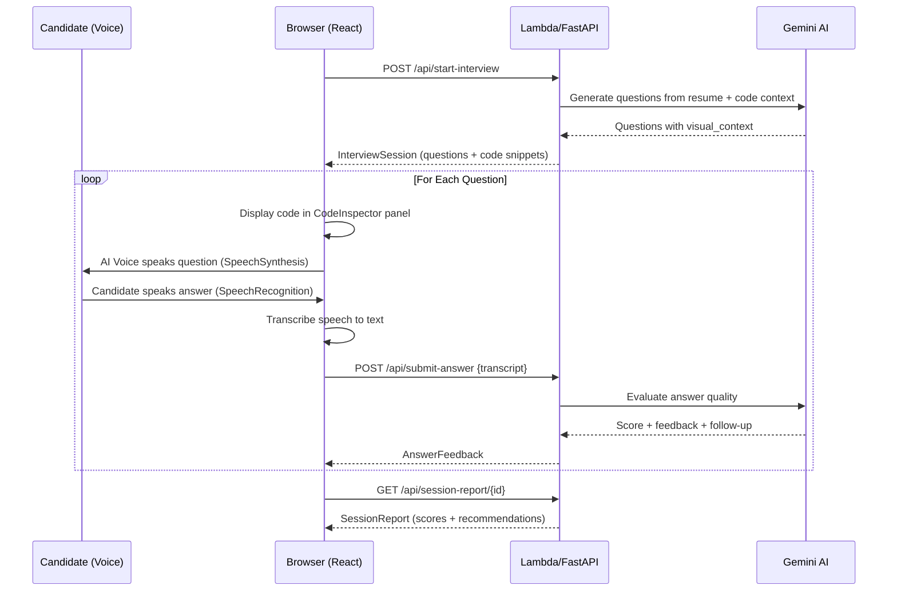

# ResumeGrind — System Architecture Document

## Overview

ResumeGrind is a serverless AI-powered mock interviewer that combines resume parsing, deep link inspection, and voice-based interviewing with real-time code visualization.

---

## High-Level Architecture

---

## Data Flow

### Phase 1: Resume Upload & Parsing

**Why `pdfplumber`?**
Most PDF libraries (PyPDF2, pdfminer) only extract visible text. But resume URLs are often embedded as hyperlink annotations — the URL is clickable but the visible text shows something else (e.g., "My Portfolio" links to `https://portfolio.dev`). `pdfplumber` extracts these annotations, catching URLs that text-only extraction would miss.

### Phase 2: Deep Link Inspection

**Why Async Concurrent Crawling?**
A resume typically contains 3-8 URLs. Crawling them sequentially with `requests` takes 3-8 seconds. Using `httpx` with `asyncio.gather()`, we crawl all URLs simultaneously in ~1 second. This is a fundamental backend optimization pattern.

### Phase 3: Voice Interview with Live Code Display

---

## Design Decisions

### Why Serverless (Lambda) Over EC2/Containers?

| Factor | Lambda (Our Choice) | EC2 / ECS |
|--------|-------------------|-----------|
| **Scaling** | Auto-scales 0→1000+ instantly | Manual scaling, load balancers |
| **Cost at zero traffic** | $0.00 | ~$8.50/month (t2.micro) |
| **Maintenance** | Zero server management | OS patches, security updates |
| **Cold starts** | ~1-2s first request | None (always running) |
| **Best for** | Sporadic traffic (portfolio projects) | Steady high traffic |

### Why DynamoDB Over PostgreSQL/MongoDB?

For interview session data (JSON documents with TTL), DynamoDB is ideal:
- **Serverless**: No database server to manage
- **Schema-flexible**: Store varied question/answer structures naturally
- **TTL**: Auto-delete old sessions (privacy + cost control)
- **Free tier**: 25GB storage is more than enough

### Why Web Speech API Over OpenAI Whisper / ElevenLabs?

| Factor | Web Speech API (Our Choice) | Server-Side AI Voice |
|--------|---------------------------|---------------------|
| **Cost** | $0 (browser-native) | $0.006-$0.015 per request |
| **Latency** | Instant (no network round-trip) | 200-500ms API call |
| **Privacy** | Audio stays on device | Audio sent to third-party server |
| **Quality** | Good (depends on browser/OS) | Premium (more natural) |
| **Offline** | Works offline | Requires internet |

---

## Security Considerations

1. **S3 Presigned URLs**: Resume files are never publicly accessible. Time-limited, authenticated URLs control access.
2. **CORS Configuration**: In production, restrict origins to your CloudFront domain only.
3. **Environment Variables**: API keys stored in Lambda environment variables (encrypted at rest by AWS).
4. **DynamoDB TTL**: Interview data auto-deletes after 7 days.
5. **S3 Lifecycle**: Resume files auto-delete after 30 days.
6. **IAM Least Privilege**: Lambda function only has access to its specific S3 bucket and DynamoDB table.
