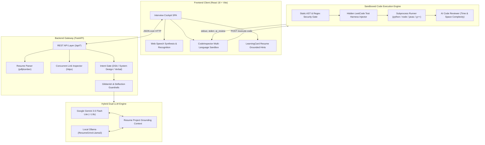

# ResumeGrind — Comprehensive System Architecture Document

## 1. Architectural Philosophy & Overview

ResumeGrind is an intelligent, resume-grounded technical interview platform designed to simulate rigorous technical screens. Unlike generic chatbots, ResumeGrind anchors every question, code challenge, and architectural critique in the candidate's actual projects, repositories, and technical claims.

```
┌────────────────────────────────────────────────────────────────────────┐
│                        RESUMEGRIND SYSTEM TIERS                        │
├───────────────────┬────────────────────────────────┬───────────────────┤
│  Client Cockpit   │       Orchestration Core       │ Sandbox & AI Core │
│  - React 18 / Vite│  - FastAPI REST Gateway        │ - Multi-Lang IDE  │
│  - Web Speech STT │  - Intent & Guardrails Engine  │ - Gemini 3.5 Lite │
│  - Lucide / Motion│  - RAG Resume Grounder         │ - Local Ollama    │
└───────────────────┴────────────────────────────────┴───────────────────┘
```

---

## 2. Component Architecture



---

## 3. Data Flow Pipelines

### Pipeline 1: Resume & Portfolio Ingestion
1. **Upload:** Candidate uploads a PDF resume (`POST /api/upload-resume`).
2. **Annotation Extraction:** `pdfplumber` extracts text and embedded hyperlink annotations (catching links hidden beneath anchor text).
3. **Concurrent Crawl:** `asyncio.gather` spawns concurrent `httpx` worker requests to GitHub REST APIs to inspect public repositories, programming languages, and recent commits.

### Pipeline 2: Intent-Gated Cross-Examination Loop
1. Candidate speaks or types an answer (`POST /api/submit-answer`).
2. **Intent Gate:** Evaluates whether candidate is pivoting to live coding (*"move on to the dsa"*) or distributed architecture (*"system design"*).
3. **Gibberish Detection:** Submissions under 5 words without technical keywords are flagged as `is_gibberish_or_trivial` and given a hard score of **2/10** with strict roasts.
4. **Adaptive Tone:** Strong technical answers (scores 8–10) receive warm validation and edge-case attacks.

### Pipeline 3: Multi-Language LeetCode Sandbox
1. Candidate writes pure function logic in Python, JavaScript, Java, or C++.
2. **AST Safety Filter:** Scans code against dangerous syscalls (`os`, `sys`, `subprocess`, `child_process`, `ProcessBuilder`, `system()`).
3. **Automated Test Harness Injection:** Injects hidden unit tests without requiring candidate to write I/O boilerplate.
4. **Execution & Review:** Returns terminal stdout/stderr alongside an automated AI complexity critique.

---

## 4. Multi-Language Compiler Specifications

| Language | Execution Target | Compiler / Toolchain | Invocation Pattern |
| :--- | :--- | :--- | :--- |
| **Python** | Python 3.14/3.11 | Python Virtualenv | `python solution.py` |
| **JavaScript** | Node.js v24 LTS | V8 Engine | `node solution.js` |
| **Java** | OpenJDK 21 LTS | `javac` + `java` | `javac Solution.java && java SolutionRunner` |
| **C++** | MinGW GCC 6.3 | G++ Compiler | `g++ -O2 solution.cpp -o solution.exe && solution.exe` |

---

## 5. Security & Isolation Model

- **Process Isolation:** All live code runs in ephemeral directories generated by `tempfile.mkdtemp()`.
- **Environment Sanitization:** Host environment variables (including `GEMINI_API_KEY`, cloud credentials, and OS keys) are stripped before subprocess launch.
- **Strict Timeouts:** Every compiler execution and program run is capped at a strict 5.0-second safety timeout.
- **Automatic Teardown:** Ephemeral files and compiled binaries are immediately unlinked from disk upon response delivery.
